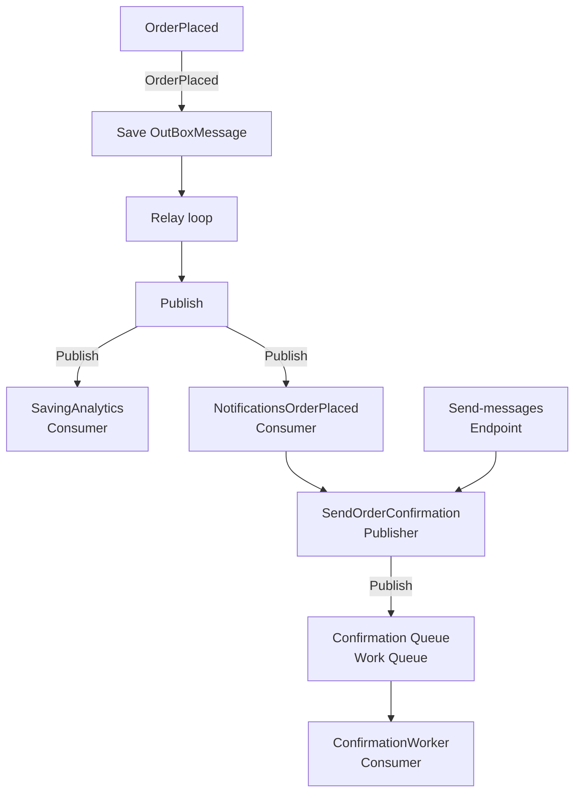

### Incident log :
i add the line `Environment.Exit(1)` after the `await transaction.CommitAsync();` and the order was saved in the database with Id `300046` but in the log
no notifications was found its mean because the test line "sever crached" between to oprations
- The order. It is Pending, and its stock was taken.
- The RabbitMQ dashboard. No message arrived. Both queues stayed empty.
- The tally. The store's sales tally did not move.

**nothing in the system said that something went wrong. No error, no failed job, no alert.**

## the delay in orderplace :
The relay was waiting 5000 ms between rounds, which broke the 2-second limit.
I set it back to 500 ms and measured again with new orders after the fix:

| Outbox row | CreatedAtUtc | SentAtUtc | Delay |
|---|---|---|---|
| 85 | 2026-11-02 21:05:04.844 | 2026-11-02 21:05:05.374 | 530 ms |
| 86 | 2026-11-02 21:46:13.251 | 2026-11-02 21:46:13.470 | 218 ms |
| 87 | 2026-11-02 21:46:29.234 | 2026-11-02 21:46:29.555 | 321 ms |
| 88 | 2026-11-02 21:46:58.387 | 2026-11-02 21:46:58.623 | 237 ms |

Result: every delay is under 2 seconds. The slowest was 530 ms. The relay waits at most 500 ms between rounds, plus the publish time. ✅

## Test A :
The app ran and did stop (crashed). When I restarted it, the relay read 50 rows from the Outbox and published the events that update the analytics and send the notifications.

After the restart, the analytics tally for the store went up by the order's amount: it was 1546.45 before and 1553.75 after (order total 7.30). ✅
## Test B :
The message cannot be sent before the order is saved, because the outbox row must be saved in the same transaction as the order. Therefore, if the relay loop finds no row, no message is sent.

## Test C — the relay dies halfway
Indeed, when I put an exception before updating the message's status and setting it to sent=true, the message was retried, but what stopped it was what was done in day-05 with the unique messageId, and it was skipped: "[15:53:44 INF] Message 3d6bc00e-d487-4828-8259-9d1340d87176 was already processed by notifications. Skipping it."

## Test D — move the message id and watch everything break
Yes, indeed, the notification was sent again:

[16:15:44 INF] Analytics updated for store with Id 1
info: 10/21/2026 16:15:44.716 RelationalEventId.CommandExecuted[20101] (Microsoft.EntityFrameworkCore.Database.Command)
      Executed DbCommand (23ms) [Parameters=[@__storeId_0='1' (Nullable = true)], CommandType='Text', CommandTimeout='30']
      SELECT [u].[Email]
      FROM [Users] AS [u]
      WHERE [u].[IsDeleted] = CAST(0 AS bit) AND [u].[Role] = 1 AND [u].[StoreID] = @__storeId_0 AND [u].[Email] IS NOT NULL
[16:15:44 INF] Notification to legros, gutmann and lindgren@al-boomeh.com: New order Order 300064, total 7.80
[16:15:48 INF] Analytics updated for store with Id 1
info: 10/21/2026 16:15:48.298 RelationalEventId.CommandExecuted[20101] (Microsoft.EntityFrameworkCore.Database.Command)
      Executed DbCommand (78ms) [Parameters=[@__orderId_0='300064'], CommandType='Text', CommandTimeout='30']
      SELECT TOP(1) [t].[Email]
      FROM [Order] AS [o]
      INNER JOIN (
          SELECT [c].[Id], [c].[Email]
          FROM [Customer] AS [c]
          WHERE [c].[IsDeleted] = CAST(0 AS bit)
      ) AS [t] ON [o].[CustomerID] = [t].[Id]
      WHERE [o].[IsDeleted] = CAST(0 AS bit) AND [o].[Id] = @__orderId_0
[16:15:48 INF] Notification to romaine28@gmail.com: Your order was placed Order 300064, total 7.80
info: 10/21/2026 16:15:48.329 RelationalEventId.CommandExecuted[20101] (Microsoft.EntityFrameworkCore.Database.Command)
      Executed DbCommand (26ms) [Parameters=[@__storeId_0='1' (Nullable = true)], CommandType='Text', CommandTimeout='30']
      SELECT [u].[Email]
      FROM [Users] AS [u]
      WHERE [u].[IsDeleted] = CAST(0 AS bit) AND [u].[Role] = 1 AND [u].[StoreID] = @__storeId_0 AND [u].[Email] IS NOT NULL
[16:15:48 INF] Notification to legros, gutmann and lindgren@al-boomeh.com: New order Order 300064, total 7.80

The rule: make the message id once, save it with the outbox row, and send the same id every time.

`SentAtUtc` is what tells me if a message was sent. The message id has another job: it lets the consumer know if it has seen this message before.

If a new id is made on each send, every copy looks like a new message, so the consumer can never skip a duplicate. With one stored id, the copy has the same id, and the consumer skips it.
## Two controlls break the rule of the day :

- POST /api/Orders/send-messages calls SendConfirmation
- POST /api/Orders/place-test-order calls BasicPublishAsync
 **they are both are test tools. They save nothing in SQL, so they open no gap**

 ## Why a BackgroundService :
 I used a background service because the requirement is that the delay be under two seconds, so I can control how often it polls for new messages and set it to every 500 ms.

If Hangfire were used instead, the shortest interval it can run at is one minute, so it isn't suitable here.

## Part 4 :
**Experiment 1 (no transaction).** I turned off the transaction and saved the tally first. I threw once before the "handled" row was saved. When the message came again, the order was counted twice (the tally went up by 2).

**Experiment 2 (my real code).** I put the transaction back and threw once after both saves, before `CommitAsync`. When the message came again, the tally went up only once.

Inside one transaction, the order of the two writes does not matter.

## Two copies of the app, one outbox :

- In the first test with 10 orders, I found no duplicate messages. The distribution was 5 per worker, and the RabbitMQ queue went from 10 to 5 to 0.

- Then I ran a bigger test with 100 orders to try to trigger the error, and again I found no duplicate messages. Still, it will certainly happen under more favorable conditions and heavier load.

- Yes, the order did break, and messages are now sent in a disorganized way. For example:

[12:40:25 INF] Analytics updated for store with Id 1
[12:40:25 INF] Notification to romaine28@gmail.com: Your order was placed Order 300051, total 7.80
[12:40:25 INF] Analytics updated for store with Id 1
[12:40:25 INF] Notification to legros, gutmann and lindgren@al-boomeh.com: New order Order 300051, total 7.80
[12:40:25 INF] Analytics updated for store with Id 1
[12:40:25 INF] Analytics updated for store with Id 1
[12:40:25 INF] Consume at 2026-11-05T09:40:25.4232551Z

The analytics was updated 3 times against a single notification to the store. Also, the confirmation is not sent until all the commands have finished for all the messages.

## The healthy outbox :
- Relay query:  SELECT TOP (50) *
 FROM [OutboxMessages] WITH (UPDLOCK, ROWLOCK, READPAST)
 WHERE SentAtUtc IS NULL AND FailedCount < 5
 AND (ReadAtUtc IS NULL OR ReadAtUtc < DATEADD(second, -30, SYSUTCDATETIME()))
 ORDER BY Id 

- Before: 295 ms. With 200,000 already-sent rows, SQL Server had no index for the WHERE predicate, so it scanned the whole clustered index to find the few unsent rows.

- the count before the cleanup is 200,000 and  after 40,004

- Fix: a filtered index that holds only the unsent rows, keyed by Id so ORDER BY Id .

- After: 20 ms (~15× faster). The plan is now an Index Seek on the small filtered index plus a Key Lookup for the 50 rows.

- Decision: Outbox rows do not take part in soft delete. The cleanup job deletes them physically.
- A row only exists to carry an event to the broker. Once it is sent, its job is done. The real data (the order, the customer, and so on) lives in its own tables, which keep soft delete.
- There is nothing to audit or restore.
- Soft delete defeats the purpose of the cleanup. It turns DELETE into UPDATE IsDeleted = 1, so the rows stay, the table keeps growing, and indexes and backups keep getting bigger. My first test proved this: the job ran.

## What the outbox does NOT do for us

1. It is not exactly-once. It is at-least-once.
The relay publishes a message, then marks the row as sent. These are two separate steps, and nothing ties them together: RabbitMQ is not part of our SQL transaction. If the app crashes after the publish succeeds but before SentAtUtc is saved, the message is already in RabbitMQ while the row still looks unsent. When the row is picked up again, the same message is published a second time. The outbox guarantees that an event is never lost, but it does not guarantee that the event arrives only once. We saw this in our own logs: lines like Message ... was already processed by notifications. Skipping it. are duplicates that reached the consumers.
A dead relay holds its rows for 30 seconds, and then another relay takes them.

2. It adds a delay.
Before, the event was published inside the request. Now it waits in the table until the next relay cycle, which runs every 500ms, and then until its batch is published. So there is always a gap between placing the order and the customer getting the notification. Usually the gap is under a second, but it grows if the relay falls behind, is stopped, or is stuck on a failing row.

3. It adds load to the database.
Every order now writes an extra row in the same transaction. The relay queries the table every 500ms even when there is nothing to send, and every sent row is updated again. The table also keeps growing, which is why we needed a filtered index (the relay query went from 295 ms to 20 ms) and a cleanup job that physically deletes sent rows older than 7 days. The broker’s work has moved partly onto SQL Server.

4. It does nothing for a consumer whose own work is unsafe to repeat.
The outbox only covers the path from our database to RabbitMQ. It ends at the publish. Because of point 1, every consumer must expect the same message more than once, and protecting itself is the consumer’s job, not the outbox’s. Our consumers do this with the ProcessedMessages table and its unique index on (MessageId, Consumer). A consumer without this protection, for example one that charges a card or sends an SMS, would do that work twice, and the outbox could not prevent it.

Also worth noting: it does not keep order.
With two relays claiming batches in parallel, plus several competing consumers and retries, events are not delivered in the order they were created.

## Other Place write to two places with no transaction :

In NotificationsOrderPlaced, when the notifications are sent, a confirmation is also sent to the store through another publisher.

## The hardest thing in the day :
The hardest part was Part 6. It was long and combined several things at once, and I had to actually see the problem happen before I could be sure my fix solved it.

To reproduce it, I created an outbox row with a broken payload and made the publisher catch the failure. At first I recorded each failure the usual way: load the row, increment FailedCount, set LastErrorMessage, then call SaveChanges. Then I found a race condition. Because this is a read-modify-write, two relays failing on the same row at the same time could both read the same count, and one increment would be lost. I fixed it with an atomic update (ExecuteUpdateAsync), which increments the counter in a single UPDATE statement in the database.

To test this, I inserted an outbox row with an invalid body ({bad json). In the publisher I added a check that throws an exception for any message whose body starts with {bad, to simulate a publish failure:

if (message.Body.StartsWith("{bad"))
    throw new InvalidOperationException("Simulated publish failure");

    | Id | MessageId | Type | Body | ProcessedOn | FailedCount | LastErrorMessage |
|---|---|---|---|---|---|---|
| 200196 | 8694C410-CBF1-AB04-6BAF-DB21F3DA3D4A | OrderPlaced | `{bad json` | NULL | 5 | Simulated publish failure |

## How two relays share the outbox :

Say what each piece does: UPDLOCK locks the 50 rows, READPAST makes the other relay skip them, ReadAtUtc marks the claim, and the 30-second limit frees the rows of a relay that died.